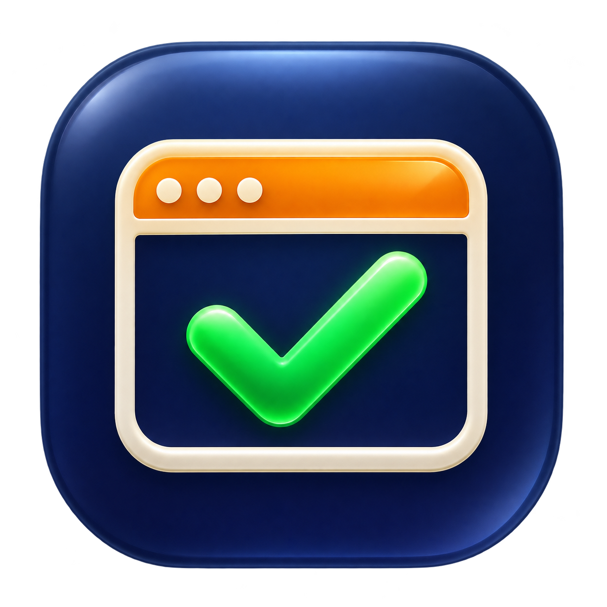

# AWS Auto Approve

<p>
  
  <a href="https://github.com/stephenlclarke/aws-auto-approve/actions/workflows/ci.yml?query=branch%3Amain"></a>
  <a href="https://github.com/stephenlclarke/aws-auto-approve/actions/workflows/unit-tests.yml?query=branch%3Amain"></a>
  <a href="https://github.com/stephenlclarke/aws-auto-approve/actions/workflows/codeql.yml?query=branch%3Amain"></a>
  <a href="https://github.com/stephenlclarke/aws-auto-approve/actions/workflows/dependency-review.yml?query=event%3Apull_request"></a>
  <a href="https://github.com/stephenlclarke/homebrew-tap/actions/workflows/homebrew.yml?query=branch%3Amain"></a>
</p>

<p>
  <a href="https://sonarcloud.io/summary/new_code?id=stephenlclarke_aws-auto-approve"></a>
  <a href="https://sonarcloud.io/summary/new_code?id=stephenlclarke_aws-auto-approve"></a>
  <a href="https://sonarcloud.io/summary/new_code?id=stephenlclarke_aws-auto-approve"></a>
  <a href="https://sonarcloud.io/summary/new_code?id=stephenlclarke_aws-auto-approve"></a>
  <a href="https://sonarcloud.io/summary/new_code?id=stephenlclarke_aws-auto-approve"></a>
  <a href="https://sonarcloud.io/summary/new_code?id=stephenlclarke_aws-auto-approve"></a>
  <a href="https://sonarcloud.io/summary/new_code?id=stephenlclarke_aws-auto-approve"></a>
  <a href="https://sonarcloud.io/summary/new_code?id=stephenlclarke_aws-auto-approve"></a>
  <a href="https://sonarcloud.io/summary/new_code?id=stephenlclarke_aws-auto-approve"></a>
  <a href="https://sonarcloud.io/summary/new_code?id=stephenlclarke_aws-auto-approve"></a>
  <a href="https://sonarcloud.io/summary/new_code?id=stephenlclarke_aws-auto-approve"></a>
</p>

<p>
  
</p>
<br clear="left" />
<br>

AWS Auto Approve is a native Swift app for macOS that clicks **Allow** on locally initiated AWS SSO requests and closes when approval completes. It works directly with AWS CLI and uses the built-in WebKit browser.

Sign in and complete DUO or other MFA when prompted. Later requests can approve automatically while the saved browser session remains valid.

## Install and use

```sh
brew tap stephenlclarke/tap
brew install --HEAD stephenlclarke/tap/aws-auto-approve
aws-auto-approve-login your-profile
```

Use `aws-auto-approve-login --if-needed your-profile` to reuse valid credentials before starting a new sign-in.

- [INSTALL.md](docs/INSTALL.md): Homebrew installation, zsh, AWS profiles, direnv, upgrades and removal.
- [BUILD.md](docs/BUILD.md): build from source, run tests and create a local app bundle.
- [SECURITY.md](SECURITY.md): approval boundaries and reporting vulnerabilities.

Requires macOS 14 or later. The current Homebrew formula builds from source and needs Xcode 16 or later. Builds have a local ad-hoc signature; a notarised installer is not yet available.

## Licence

[MIT](LICENSE), copyright 2026 Stephen Clarke.
